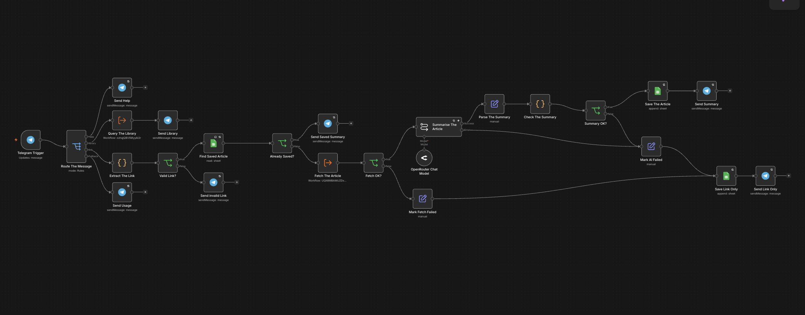
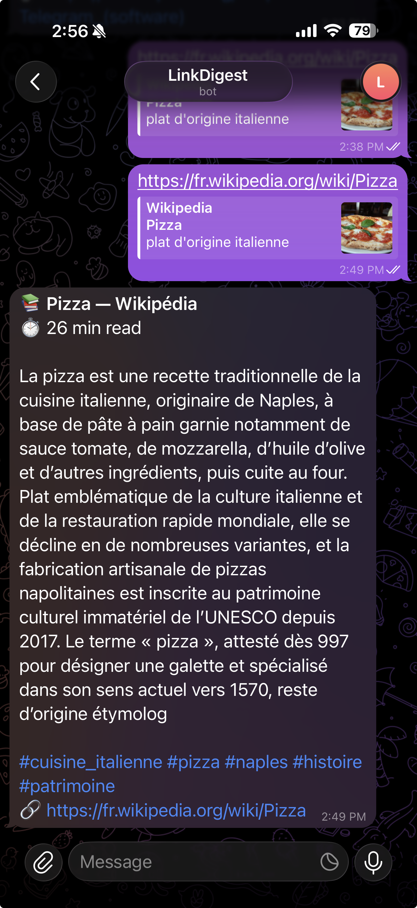
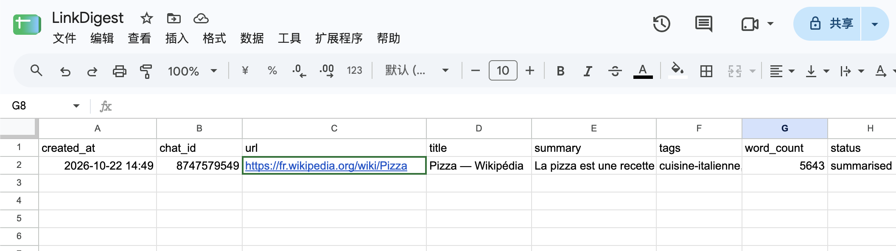

# LinkDigest Bot

A Telegram read-later assistant built with n8n. Send the bot an article link: it fetches the page, a free AI model writes a three-sentence summary with 3 to 5 tags, the article is saved, and the bot replies with the summary. `/list` shows your latest saves and `/search <keyword>` finds one again.



## What it does

| You send | The bot |
| --- | --- |
| an article link | fetches it, summarises it with AI, saves it, replies with title, reading time, summary and tags |
| the same link again | replies with the stored summary at once (no AI call, no duplicate row) |
| `/list` | lists your 10 latest saved articles |
| `/search <keyword>` | finds saved articles by title, tag or summary |
| `/help` or `/start` | shows the available commands |
| a dead or blocked page | saves the link only (`fetch_failed`) and tells you |
| `http://localhost:5678` or another internal address | refuses it (security) |
| anything else | explains it only understands links |

## Architecture

One main workflow, two sub-workflows and one error workflow. Only a new, readable link reaches the AI.

```
Telegram Trigger
  → Route The Message (Switch)
      /help, /start   → Send Help
      /list, /search  → Query The Library (sub-workflow) → Send Library
      fallback        → Send Usage
      link            → Extract The Link (Python) → Valid Link? (If)
                          no  → Send Invalid Link
                          yes → Find Saved Article (Google Sheets) → Already Saved? (If)
                                  yes → Send Saved Summary
                                  no  → Fetch The Article (sub-workflow) → Fetch OK? (If)
                                          no  → Mark Fetch Failed → Save Link Only → Send Link Only
                                          yes → Summarise The Article (LLM Chain + OpenRouter, free model)
                                                  error → Mark AI Failed → Save Link Only → Send Link Only
                                                  ok    → Parse The Summary (Set) → Check The Summary (Python)
                                                          → Summary OK? (If) → Save The Article (Google Sheets) → Send Summary
```

| Workflow | File | Role |
| --- | --- | --- |
| LinkDigest Bot | `workflows/linkdigest_main.json` | Telegram entry point, routing, AI summary, saving, replies |
| fetch_article_subworkflow | `workflows/fetch_article_subworkflow.json` | fetches the page and extracts its text; falls back to Jina Reader for blocked or JavaScript-only pages |
| library_query_subworkflow | `workflows/library_query_subworkflow.json` | answers `/list` and `/search` from the saved articles |
| error_alert | `workflows/error_alert.json` | Error Trigger: sends the owner a Telegram alert with the workflow name, failed node and execution URL |

The full specification and diagram are in the project proposal.

## Repository layout

```
.
├── docker-compose.yml     # n8n + Postgres + Python task runner, pinned versions, named volumes
├── .env.example           # every variable needed, without real values
├── .gitignore             # keeps .env and local data out of Git
├── workflows/             # n8n workflows exported as JSON (same version as the demo)
└── *.png                  # screenshots used in this README
```

## Setup: from clone to running

**Requirements:** Docker with Docker Compose, a Telegram account, an OpenRouter account, a Google account.

1. **Clone and configure**
   ```bash
   git clone <this-repo-url>
   cd linkdigest-bot
   cp .env.example .env
   ```
   Fill in `.env` (see the table below). Generate secrets with `openssl rand -hex 32`.

2. **Start n8n**
   ```bash
   docker compose up -d
   ```
   Postgres starts first; n8n waits until its healthcheck passes. Open `http://localhost:5678` and create the owner account. Workflows and credentials are stored in the `n8n_data` and `postgres_data` volumes, so they survive `docker compose down` and `up`.

3. **Expose n8n over HTTPS.** Telegram only delivers messages to a public `https://` URL. Locally, run a tunnel (for example `cloudflared tunnel --url http://localhost:5678`) and put its URL in `WEBHOOK_URL`, then `docker compose up -d` again.

4. **Create the credentials in n8n** (Credentials → Add credential):
   - **Telegram API**: bot token from [@BotFather](https://t.me/BotFather) (`/newbot`)
   - **OpenRouter**: API key from openrouter.ai, with a small credit limit; select a model ending in `:free`
   - **Google Sheets OAuth2**: sign in with Google

5. **Create the Google Sheet** `LinkDigest` with a tab `articles` and this header row:
   ```
   created_at | chat_id | url | title | summary | tags | word_count | status
   ```

6. **Import the workflows** (Workflows → Import from file), in this order: `fetch_article_subworkflow.json`, `library_query_subworkflow.json`, `error_alert.json`, then `linkdigest_main.json`. In each node, pick your own credentials and your Google Sheet; in Execute Workflow nodes, re-select the sub-workflows.

7. **Link the error workflow**: in each workflow, ⋯ → Settings → Error Workflow → `error_alert`. In `error_alert`, set the Chat ID to your own Telegram chat id.

8. **Publish** the two sub-workflows, then the main workflow. Only one workflow may listen to a given bot at a time.

## Environment variables

| Variable | Purpose |
| --- | --- |
| `N8N_VERSION` | n8n image tag, pinned to the version used for the demo |
| `WEBHOOK_URL` | public HTTPS URL of n8n, needed by the Telegram webhook |
| `N8N_ENCRYPTION_KEY` | encrypts stored credentials; keep it, or saved credentials become unreadable |
| `N8N_RUNNERS_AUTH_TOKEN` | shared secret between n8n and the Python task runner |
| `GENERIC_TIMEZONE` | timezone for timestamps |
| `POSTGRES_USER`, `POSTGRES_PASSWORD`, `POSTGRES_DB` | n8n's own Postgres database |

Bot tokens and API keys are never put in `.env` or in Git: they live only in n8n's encrypted credentials.

## How to test

Send these messages to the bot and check the reply, the Google Sheet and the Executions tab:

| Message | Expected result | AI calls |
| --- | --- | --- |
| `/help` | command list | 0 |
| a new article link | summary with title, reading time and tags; new row with status `summarised` | 1 |
| the same link again | "Already in your library", no new row | 0 |
| `/list`, `/search <tag>` | numbered list of saved articles | 0 |
| `https://example.com/this-page-does-not-exist` | "saved the link only", row with status `fetch_failed` | 0 |
| `http://localhost:5678` | refused as a private address | 0 |
| `hello` | usage message | 0 |

Each sub-workflow can also be tested alone with the mock data pinned on its trigger.

## Screenshots




## Robustness and security

- **Retry On Fail** on every external call (HTTP, Google Sheets, AI, Telegram).
- The AI output is validated in Python; an empty or failed summary goes to a fallback path that still saves the link (`ai_failed`).
- Duplicate links are detected before any AI call, so the same input never creates a second row.
- User-sent URLs pointing to internal addresses are refused, so the bot cannot be used to reach the server's own services (SSRF).
- Replies are sent in Telegram HTML mode with escaping, so titles or links containing `_` or `<` cannot break a message.
- The article text is passed to the model as data only; the prompt tells it to ignore instructions inside the page.

## Known limitations

- The demo instance runs on n8n Cloud; this repository's Docker Compose file is the self-hosted setup.
- Articles are stored in a Google Sheet: fine for one user and a few hundred rows. A larger version would move them to Postgres with a unique key on `chat_id + url` and full-text search.
- Reading time is computed from the whole page, so long pages (for example Wikipedia) show a higher estimate.
- Free OpenRouter models and Jina Reader are rate-limited.
